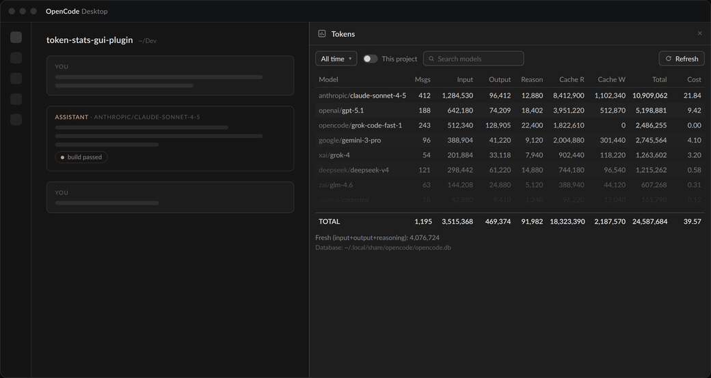

# Token Stats for OpenCode Desktop

A side-panel plugin for OpenCode 2 Desktop that shows how many tokens each model consumed,
across every session on the machine.

Columns: model, messages, input, output, reasoning, cache read, cache write, total, cost.
Below the table: a TOTAL row and the "fresh" figure (input + output + reasoning). Filters:
all time, today, 7 days, and optionally only the current session's project directory.



Русская версия: [README.ru.md](README.ru.md).

## Requirements

- OpenCode Desktop 2.3.x. The GUI plugin API is experimental and may change between releases.
- Node.js 20+ only if you build the plugin yourself; the repository ships the built
  `dist/gui-experimental.cjs`.

## Install from git (recommended)

```bash
git clone https://github.com/edwardgra4ev/opencode-token-stats-gui-plugin \
  ~/.config/opencode/plugins/token-stats
```

Add the plugin to `~/.config/opencode/opencode.json`:

```jsonc
{
  "plugins": ["./plugins/token-stats"],
}
```

Restart OpenCode Desktop once. The panel then appears in the side region's `+` menu, in the
command palette, and on `/tokens`.

## Install from a release archive

1. Download `opencode-token-stats-gui-plugin-vX.Y.Z.zip` from
   [Releases](https://github.com/edwardgra4ev/opencode-token-stats-gui-plugin/releases).
2. Unzip it into `~/.config/opencode/plugins/token-stats`.
3. Add `"./plugins/token-stats"` to `plugins` in `~/.config/opencode/opencode.json`.
4. Restart Desktop.

The archive already contains `dist/gui-experimental.cjs`; no build step is needed.

## Install elsewhere

The plugin also loads from any directory. Point `plugins` at it directly, absolute or
relative to the config directory:

```jsonc
{
  "plugins": ["/mnt/hdd/Dev/linux/token-stats-gui-plugin"],
}
```

## Database location

The plugin looks for `opencode.db` where OpenCode itself keeps its data:

| OS | Path |
| --- | --- |
| Linux | `$XDG_DATA_HOME/opencode/opencode.db`, default `~/.local/share/opencode/opencode.db` |
| macOS | `~/Library/Application Support/opencode/opencode.db` |
| Windows | `%APPDATA%\opencode\opencode.db` |

Channel builds (`opencode-dev.db`, `opencode-beta.db`, …) are picked up automatically when
`opencode.db` does not exist. The resolved path is shown under the table and in the error
banner.

To point the plugin at another file, set the `db` option (absolute, `~/…`, or relative to
the data directory above):

```jsonc
{
  "plugins": [
    {
      "package": "./plugins/token-stats",
      "options": { "db": "~/backups/opencode.db" }
    }
  ],
}
```

The same variable OpenCode uses also works: `OPENCODE_DB`. Precedence is the plugin option,
then `OPENCODE_DB`, then the platform default.

## Usage

- Open the side panel, click `+`, pick **Tokens**; or run `/tokens`; or use the command
  palette.
- Pick a period and, optionally, **This project** to limit the numbers to the directory of
  the session you are in.
- Click a column header to sort by it, click again to reverse; the model column sorts
  alphabetically. The first click sorts numbers descending.
- Type in **Search models** to filter rows by `provider/model`; TOTAL and the fresh figure
  follow the visible rows.
- **Refresh** re-reads the database; there is no polling.

## Update

```bash
git -C ~/.config/opencode/plugins/token-stats pull
```

Then restart Desktop (or reload plugins from the app). Releases are tagged `vX.Y.Z`; see
[CHANGELOG.md](CHANGELOG.md).

## How the numbers are computed

- Source: the OpenCode data directory, table `session_message`, rows with
  `type = 'assistant'` (see [Database location](#database-location)).
- Token buckets come from the message's `tokens` field: `input`, `output`, `reasoning`,
  `cache.read`, `cache.write`; `cost` from the message.
- `total = input + output + reasoning + cache read + cache write`.
- "Fresh" is `input + output + reasoning`, money-wise the part that was not served from
  the prompt cache.
- Rows are sorted by `input + output + cache read`, the same order as the reference
  aggregator `opencode-token-stats.py`. Totals, fresh and row order were verified equal to
  it on a real database snapshot.
- The database is opened read-only for each request; WAL mode allows reading while
  OpenCode runs.

Costs are `0.00` on free and subscription-backed providers. The current, unfinished
assistant message is counted as a message with zero tokens. Only this machine and
profile are covered.

## Development

```bash
npm install
npm run typecheck
npm run build     # dist/gui-experimental.cjs, committed
npm run watch     # rebuild on change; reloads the panel in every window
```

`dist/` is tracked so that a plain `git clone` installs without a build. CI rebuilds it and
fails when it differs from the committed bundle.

The README animation is generated from a standalone replica of the panel:
`node preview/render.mjs` (headless Chrome + ffmpeg) rewrites `preview/token-stats.gif` and
`preview/token-stats.mp4`.

Structure:

| Path | Purpose |
| --- | --- |
| `src/index.ts` | server part: `Plugin.define({ id: "token-stats" })`, registers the RPC |
| `src/rpc.ts` | RPC contract `stats`, shared by both parts |
| `src/stats.ts` | SQLite read and aggregation |
| `src/gui.tsx` | GUI entry: panel, menu item, `/tokens` command, styles |
| `src/gui/panel.tsx` | Solid view |
| `src/gui/definition.ts`, `src/gui/i18n.ts` | declarations, en/ru copy |
| `preview/index.html`, `preview/render.mjs` | animated README preview: panel replica and its frame renderer |

Releases: bump `version` in `package.json`, add a `CHANGELOG.md` entry, tag `vX.Y.Z` and
push the tag. The release workflow checks the tag against `package.json`, rebuilds, and
attaches the plugin archive.

## License

MIT — see [LICENSE](LICENSE).
